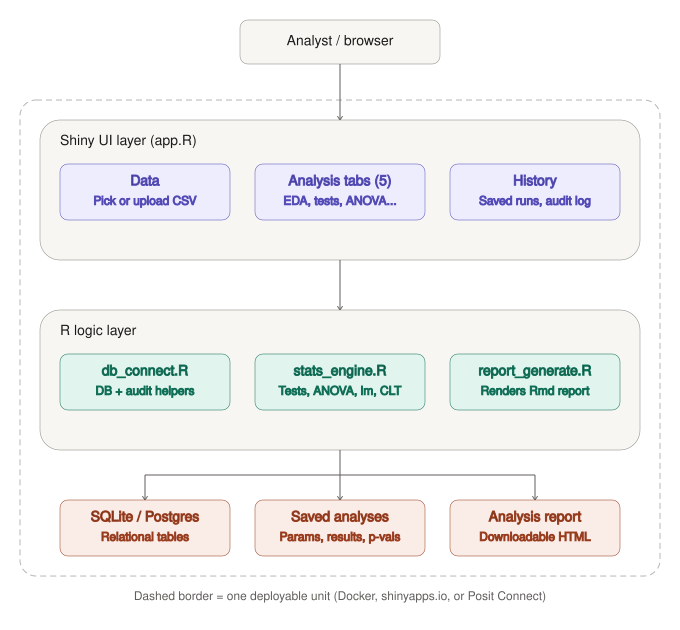

# Statistical Analysis Studio

An end-to-end R Shiny product for general-purpose statistical analysis:
upload any CSV (or pick a built-in example), run exploratory data
analysis, hypothesis tests, ANOVA, regression, and CLT simulations, save
any analysis to a database, download it as a report, and review a full
audit trail — the same product architecture as the
[Diabetes Risk Screening](../Healthcare-Diabetes-Risk-Predictor-v2) project
in this portfolio, applied to a general statistics tool instead of a
single ML model.


## 1. Business problem

Analysts and students frequently need a quick, trustworthy way to run
standard statistical procedures (t-tests, ANOVA, regression, CLT
demonstrations) on a new dataset without writing R code each time, while
still being able to save, reproduce, and share exactly what was run and
why. This app turns a semester of introductory-statistics coursework into
a self-serve tool: pick or upload data, run an analysis, save it, download
a report, and see a complete history of what's been done.

**Target users:** data analysts, statistics students/instructors, anyone
who wants a no-code interface over standard R statistical routines.

**Why this matters for hiring managers:** it shows the same "product, not
notebook" skill set as the healthcare project — a persistent database, an
audit trail, testable business logic separated from the UI, and a
reproducible, deployable artifact — applied generically instead of to one
fixed model, which demonstrates the pattern transfers.

## 2. Architecture



```
Browser (Shiny UI)
      |
   app.R  ──sources──>  modules/{mod_data, mod_eda, mod_hypothesis,
      |                            mod_anova, mod_regression, mod_clt, mod_audit}.R
      |
   R/db_connect.R  <───>  SQLite (local demo) / PostgreSQL (prod-like demo)
      |
   R/stats_engine.R  ──runs──>  t-tests, ANOVA, lm(), CLT simulation
      |
   R/report_generate.R  ──renders──>  reports/report_template.Rmd  ──>  downloadable HTML
```

Data flow: a user picks a built-in dataset or uploads a CSV on the **Data**
tab → `register_dataset()` records it in the `datasets` table (reusing the
row if it's a built-in dataset seen before) → each analysis tab runs its
statistic via `R/stats_engine.R` → clicking **Save this analysis** calls
`save_analysis()`, which writes to `analyses` and logs a `RUN_*` action to
`audit_log` → **Download report** renders `reports/report_template.Rmd`
into a standalone HTML file and logs a `GENERATE_REPORT` action.

## 3. Folder structure

```
Statistical-Analysis-Studio-v2/
├── app.R                       # main Shiny app (sources everything below)
├── Dockerfile
├── README.md
├── SETUP_AND_DEPLOY.md
├── db/
│   ├── schema.sql              # DDL + seed inserts
│   └── init_db.R               # creates the (empty) db schema
├── R/
│   ├── db_connect.R            # DBI connection + register_dataset/save_analysis/log_action
│   ├── data_ingestion.R        # built-in datasets + column-type helpers + CSV reader
│   ├── stats_engine.R          # testable t-test/ANOVA/regression/CLT functions
│   └── report_generate.R       # renders the Rmd report
├── modules/
│   ├── mod_data.R              # dataset picker/upload
│   ├── mod_eda.R                # exploratory data analysis
│   ├── mod_hypothesis.R        # one/two-sample t-test + Wilcoxon
│   ├── mod_anova.R              # one-way ANOVA + Tukey HSD
│   ├── mod_regression.R        # linear regression + live prediction
│   ├── mod_clt.R                 # distribution & CLT simulator
│   └── mod_audit.R              # analysis history + audit log
├── reports/
│   └── report_template.Rmd     # generic per-analysis report template
├── docs/
│   └── architecture-diagram.svg
└── tests/testthat/             # unit tests for stats_engine + db helpers
```

## 4. R package stack

`shiny`, `bslib`, `ggplot2`, `dplyr`, `tidyr`, `DT`, `scales`, `DBI`,
`RSQLite` (`RPostgres` for prod-like demo), `jsonlite`, `rmarkdown`,
`testthat`.

## 5. Local run steps

```r
install.packages(c(
  "shiny","bslib","ggplot2","dplyr","tidyr","DT","scales","DBI","RSQLite",
  "jsonlite","rmarkdown","testthat"
))
```

```bash
# 1) Initialize the database schema (creates db/stats_studio.sqlite)
Rscript db/init_db.R --reset

# 2) Run the app
R -e "shiny::runApp('app.R')"

# 3) (optional) Run tests
R -e "testthat::test_dir('tests/testthat')"
```

## 6. Docker (portable demo)

```bash
docker build -t stats-studio-demo .
docker run -p 3838:3838 stats-studio-demo
# open http://localhost:3838
```

## 7. Deploying for a customer/portfolio link

`rsconnect::deployApp(appDir = ".")` after setting up a shinyapps.io
account — same workflow as the healthcare app. See `SETUP_AND_DEPLOY.md`
for full step-by-step instructions.

## 8. What each tab demonstrates

| Tab | Statistical method | Notes |
|---|---|---|
| Explore (EDA) | Summary stats, histograms, boxplots, correlation matrix | Works on any numeric/categorical columns |
| Hypothesis Testing | One/two-sample t-test, Wilcoxon signed-rank | Adjustable alpha/alternative, live decision text |
| ANOVA | One-way ANOVA + Tukey HSD | Any numeric response x categorical group (2+ levels) |
| Regression | Linear regression, optional interaction term | Live prediction form with 95% prediction interval |
| Distribution & CLT Lab | Normal/Beta/Uniform/Exponential simulation | Visualizes the Central Limit Theorem with adjustable n and replications |

**Known limitations:** median imputation isn't used here (unlike the
healthcare project) because this tool is meant to work on arbitrary user
data where the "right" cleaning strategy varies — users are expected to
upload already-reasonably-clean data, or use the EDA tab first to spot
issues before running tests.

## 9. Demo workflow (for a screen recording)

1. **Home tab** — 10 seconds on what the product does.
2. **Data** — select the Iris built-in dataset, then show uploading a
   custom CSV instead.
3. **Explore (EDA)** — pick a numeric variable, switch plot types, save
   the analysis, download the report.
4. **Hypothesis Testing** — run a one-sample t-test, show the decision
   text update live as alpha changes, save it.
5. **ANOVA** and **Regression** — quickly show Tukey HSD and a live
   prediction with a slider.
6. **Distribution & CLT Lab** — bump the sample size slider from 1 to
   200 and narrate the sampling distribution tightening around the mean.
7. **Analysis History** — show every analysis just saved, with its
   dataset, p-value, and timestamp, plus the underlying audit log.

## 10. Troubleshooting checklist

- Blank dropdowns on any analysis tab → make sure a dataset is loaded on the **Data** tab first.
- `could not find function "value_box"` / `page_navbar"` → update `bslib`.
- `unable to find an inherited method for function 'dbConnect'` → install `RSQLite`.
- "Save this analysis" does nothing → check the console for validation errors (e.g. no numeric variable selected).
- Docker build fails installing packages → retry (CRAN mirror occasionally throttles concurrent installs).

## 11. Reproducibility checklist

- [ ] `db/init_db.R --reset` runs clean on a fresh clone
- [ ] `testthat::test_dir("tests/testthat")` passes
- [ ] App launches with `shiny::runApp("app.R")` with no manual edits
- [ ] Docker image builds and serves on port 3838

## 12. Resume bullet points

- Built and deployed a database-backed R Shiny statistical analysis platform (EDA, hypothesis testing, ANOVA, regression, CLT simulation) that works on any uploaded dataset, with a SQLite/PostgreSQL-backed audit trail of every analysis and report generated.
- Refactored statistical routines (t-tests, ANOVA, regression, CLT simulation) out of UI code into a unit-tested R package-style module (`stats_engine.R`), reused across five Shiny modules.
- Designed a normalized database schema (datasets, analyses, audit log) supporting reproducible, reviewable analysis history.
- Delivered downloadable, auto-generated HTML reports (R Markdown) per saved analysis.

## 13. LinkedIn post summary

"Turned a set of intro-stats homework exercises into a full R Shiny
product: upload any dataset, run t-tests/ANOVA/regression/CLT simulations,
save results to a database, and download a report — with a complete audit
trail. Same architecture pattern as my healthcare risk-screening app, this
time generalized to any dataset instead of one fixed model.
#rstats #shiny #datascience"

## 14. Clean coding standards used

- Statistical logic (`R/stats_engine.R`) fully separated from UI/reactive code and unit-tested independently
- Shiny modules (`NS()`, `moduleServer()`) instead of one monolithic server function
- All SQL parameterized via `DBI::dbExecute(..., params = list(...))`
- Consistent naming (`snake_case` R objects, `UPPER_CASE` audit-log action strings)
- Config via environment variables (`APP_DB_BACKEND`, `PGHOST`, etc.) rather than hard-coded credentials
